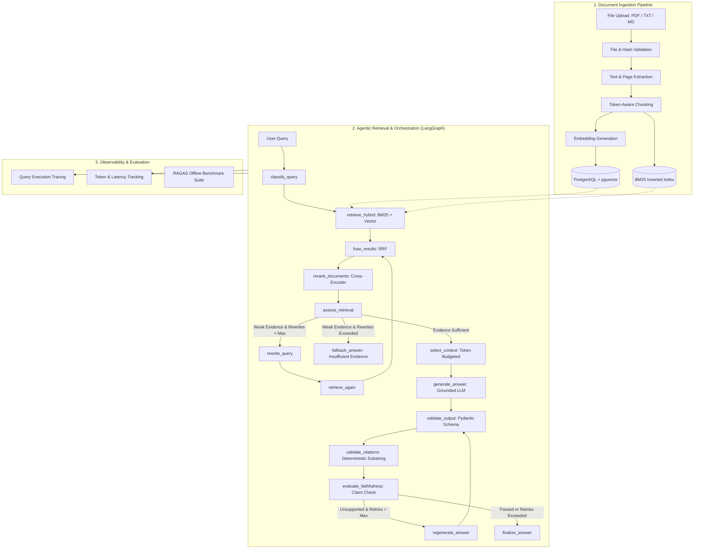

# Architecture & Technical Design: Agentic RAG Platform

## 1. System Overview

This system is a production-grade, bounded Agentic Retrieval-Augmented Generation (RAG) platform. Unlike naive chatbot wrappers, it provides end-to-end verification, hybrid dense/sparse retrieval with Reciprocal Rank Fusion (RRF), cross-encoder reranking, bounded LangGraph orchestration with query rewriting loops, deterministic citation verification, faithfulness evaluation, and offline RAGAS metrics.

## 2. Core Subsystems

### 2.1 Multi-Modal Ingestion Engine
- **Supported Formats**: PDF (PyPDF / pdfplumber), plain text (.txt), Markdown (.md).
- **Validation**: MIME type checking, magic bytes, max file size enforcement (default: 25MB), SHA-256 deduplication.
- **Token-Aware Chunking**: Uses target token boundaries (e.g. 512 tokens with 64 token overlap) using tokenizer encoding, respecting paragraph and sentence boundaries.
- **Dual Indexing**:
  1. Dense representations stored in PostgreSQL `document_chunks` with `pgvector` indexing (HNSW / IVFFlat).
  2. Sparse representations indexed in a persistent BM25 indexer with token normalization and technical entity preservation.

### 2.2 Hybrid Retrieval Engine & Reciprocal Rank Fusion (RRF)
- **Dense Vector Search**: Computes query embedding using Sentence Transformers or configured API, performs cosine similarity against pgvector.
- **Sparse BM25 Search**: Matches query tokens, exact keywords, and acronyms against BM25 inverted index.
- **Reciprocal Rank Fusion**:
  $$RRF(d) = \sum_{m \in M} \frac{1}{k + \text{rank}_m(d)}$$
  Where $k$ is a smoothing constant (default: 60), $M = \{\text{dense}, \text{sparse}\}$, and $\text{rank}_m(d)$ is the 1-based rank of document chunk $d$ in system $m$.
- **Cross-Encoder Reranker**: Passes top $N$ fused candidates through a cross-encoder model scoring $(q, d)$ interaction directly.

### 2.3 Bounded LangGraph Agent Workflow
Every loop in the agent workflow is bounded by deterministic state conditions:
- **Max Query Rewrites**: Configurable (default: 2). If evidence remains below relevance threshold after 2 rewrites, route immediately to `fallback_answer`.
- **Max Generation Retries**: Configurable (default: 1). If generated answer fails citation verification or faithfulness checks, regenerate once with explicit evidence constraints; if it fails again, emit a controlled partial or abstention response.

### 2.4 Deterministic Citation & Faithfulness Verification
1. **Citation Verification**: Every citation emitted by the LLM must map to a chunk ID in the retrieved context set. The `quoted_text` must exist as a verbatim substring (or normalized sequence match $> 85\%$ character similarity) within that specific chunk.
2. **Faithfulness Checking**: Claims made in the answer are cross-checked against selected context. If hallucinated facts or ungrounded external assertions are detected, the verification score drops below threshold, triggering regeneration.

### 2.5 Offline Evaluation Suite (RAGAS)
Provides an evaluation pipeline computing standard RAG metrics:
- **Faithfulness**: Proportion of answer claims supported by context.
- **Answer Relevancy**: Semantic relevance of answer to query.
- **Context Precision**: Signal-to-noise ratio of retrieved chunks.
- **Context Recall**: Extent to which retrieved context contains ground truth answers.
- **A/B Configuration Benchmarking**: Compares BM25 vs Dense vs Hybrid vs Hybrid+Reranker.
