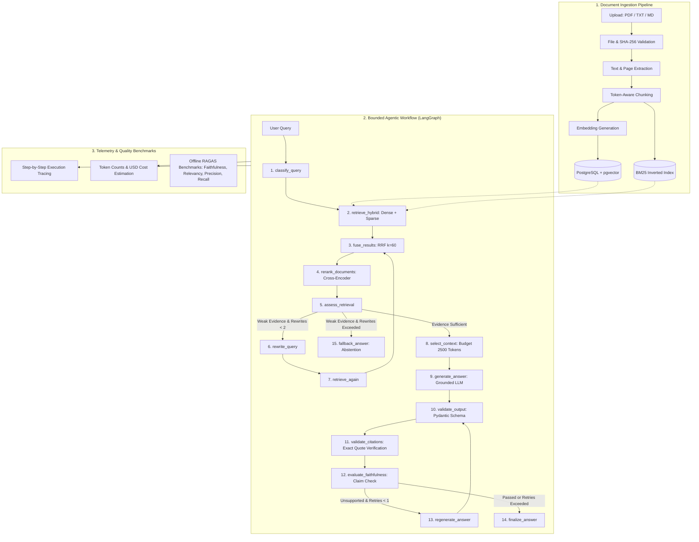

# Enterprise Agentic RAG Intelligence Platform

[](https://www.python.org/)
[](https://fastapi.tiangolo.com/)
[](https://nextjs.org/)
[](https://github.com/pgvector/pgvector)
[](https://pytest.org/)

A production-grade, bounded **Agentic Retrieval-Augmented Generation (RAG)** platform designed for enterprise document intelligence. Engineered from first principles with hybrid dense/sparse retrieval, Reciprocal Rank Fusion (RRF), cross-encoder reranking, bounded LangGraph orchestration with query rewriting loops, deterministic citation verification, faithfulness evaluation, and offline RAGAS metrics.

---

## 1. Architecture



---

## 2. Core Capabilities

- **Multi-Format Ingestion**: Streaming parsers for PDF, TXT, and Markdown with recursive token chunking (default: 512 tokens with 64 token overlap), SHA-256 deduplication, and page number tracking.
- **Dense Vector Search**: pgvector cosine similarity index (`Vector(384)`) supporting SentenceTransformers (`all-MiniLM-L6-v2`) and provider APIs.
- **Sparse BM25 Search**: BM25Plus keyword retrieval retaining technical tokens, API keys, error codes, and camelCase identifiers.
- **Reciprocal Rank Fusion (RRF)**: $RRF(d) = \sum \frac{1}{k + \text{rank}_i(d)}$ with $k=60$ to combine dense and sparse rankings scale-invariantly.
- **Cross-Encoder Reranking**: Pairwise transformer scoring (`cross-encoder/ms-marco-MiniLM-L-6-v2`) outputting contextual relevance scores.
- **Bounded LangGraph Agent**: 15-node state machine with strict loop bounds (max 2 query rewrites, max 1 regeneration).
- **Deterministic Citation Verification**: Enforces that all citation chunk IDs exist in retrieved context and `quoted_text` is an exact match in the source chunk.
- **Faithfulness Claim Checking**: Assesses factual grounding against retrieved evidence; triggers controlled abstention on hallucination.
- **Automated Fallbacks**: Handles prompt injection threats, weak retrieval, schema parse errors, empty context, and provider timeouts.
- **Offline RAGAS Benchmarks**: Measures Faithfulness, Answer Relevancy, Context Precision, and Context Recall across retrieval strategies.
- **Observability & Cost Management**: Tracks prompt/completion tokens, latency per node, estimated USD cost, and query execution traces.

---

## 3. Technology Stack

- **Backend**: Python 3.11+, FastAPI, Pydantic v2, SQLAlchemy 2.0, Alembic, rank-bm25, tiktoken, pypdf, pgvector.
- **Frontend**: Next.js 14 (App Router), TypeScript, Tailwind CSS, Lucide React.
- **Database**: PostgreSQL 16 + pgvector extension (with zero-config SQLite local fallback for development/testing).
- **Deployment**: Docker, Docker Compose, Uvicorn, Node Alpine runner.

---

## 4. Quickstart Guide

### Option A: Run with Docker Compose (Production Stack)
Ensure Docker Desktop is running, then execute:
```bash
docker compose up --build
```
- **Frontend Research Dashboard**: `http://localhost:3000`
- **FastAPI Backend & Swagger Docs**: `http://localhost:8000/api/docs`
- **PostgreSQL + pgvector**: `localhost:5432`

---

### Option B: Run Locally (Development Mode)

#### 1. Backend Setup
```bash
# From workspace root
python -m venv .venv
# Windows:
.venv\Scripts\activate
# Linux/macOS:
source .venv/bin/activate

pip install -r backend/requirements.txt

# Start FastAPI backend (runs on SQLite local fallback automatically)
python -m uvicorn app.main:app --app-dir backend --reload --port 8000
```
API Documentation will be live at `http://localhost:8000/api/docs`.

#### 2. Frontend Setup
```bash
cd frontend
npm install
npm run dev
```
Open `http://localhost:3000` in your browser.

---

## 5. Running Tests

The test suite includes unit tests, integration tests, and failure tests covering chunking, RRF fusion, citation verification, query rewriting, fallback logic, and RAGAS metrics:

```bash
# Set PYTHONPATH to include backend
$env:PYTHONPATH="backend"   # PowerShell
# or export PYTHONPATH=backend  # Bash

python -m pytest backend/tests -v
```

### Test Results Summary
```
backend/tests/test_api_chat.py::test_chat_flow_and_tracing PASSED
backend/tests/test_api_documents.py::test_document_lifecycle PASSED
backend/tests/test_chunking.py::test_plain_text_chunking PASSED
backend/tests/test_chunking.py::test_markdown_chunking_with_headers PASSED
backend/tests/test_chunking.py::test_empty_document_rejection PASSED
backend/tests/test_chunking.py::test_unsupported_format_rejection PASSED
backend/tests/test_chunking.py::test_token_counting_accuracy PASSED
backend/tests/test_citation_validation.py::test_valid_citation PASSED
backend/tests/test_citation_validation.py::test_invalid_chunk_id_rejection PASSED
backend/tests/test_citation_validation.py::test_fabricated_quote_rejection PASSED
backend/tests/test_evaluation.py::test_ragas_metrics_computation PASSED
backend/tests/test_evaluation.py::test_evaluation_api_endpoints PASSED
backend/tests/test_fallbacks.py::test_prompt_injection_defense PASSED
backend/tests/test_fallbacks.py::test_weak_retrieval_insufficient_evidence_fallback PASSED
backend/tests/test_fallbacks.py::test_empty_context_fallback PASSED
backend/tests/test_query_rewriting.py::test_bounded_query_rewriting PASSED
backend/tests/test_query_rewriting.py::test_avoid_duplicate_rewrites PASSED
backend/tests/test_retrieval.py::test_bm25_technical_token_matching PASSED
backend/tests/test_retrieval.py::test_embedding_cosine_similarity PASSED
backend/tests/test_retrieval.py::test_reranker_relevance_sorting PASSED
backend/tests/test_rrf.py::test_rrf_scoring_and_deduplication PASSED
backend/tests/test_rrf.py::test_rrf_deterministic_ordering PASSED
backend/tests/test_rrf.py::test_rrf_scale_independence PASSED
backend/tests/test_token_budget.py::test_token_budget_enforcement PASSED
backend/tests/test_token_budget.py::test_chunk_deduplication_in_budget PASSED
backend/tests/test_token_budget.py::test_cost_calculation PASSED
============================== 26 passed in 0.37s ==============================
```

---

## 6. Environment Variables Reference

| Variable | Description | Default |
| :--- | :--- | :--- |
| `DATABASE_URL` | PostgreSQL or SQLite connection string | `sqlite:///./rag_local.db` |
| `VECTOR_DIMENSION` | Dimension of embedding vectors | `384` |
| `EMBEDDING_MODEL_NAME` | SentenceTransformers embedding model | `sentence-transformers/all-MiniLM-L6-v2` |
| `RERANKER_MODEL_NAME` | CrossEncoder reranker model | `cross-encoder/ms-marco-MiniLM-L-6-v2` |
| `RRF_K` | Smoothing constant for RRF | `60` |
| `RETRIEVAL_TOP_K` | Number of initial candidates per retriever | `10` |
| `RERANK_TOP_K` | Number of candidates after cross-encoder | `5` |
| `MAX_QUERY_REWRITES` | Maximum allowed query rewrites before abstention | `2` |
| `MAX_GENERATION_ATTEMPTS` | Maximum generation retries on verification failure | `2` |
| `CONTEXT_TOKEN_BUDGET` | Maximum tokens allowed for generation context | `2500` |
| `MIN_RELEVANCE_SCORE_THRESHOLD` | Threshold to trigger query rewriting | `0.35` |
| `LLM_PROVIDER` | LLM Provider (`mock`, `openai`, `anthropic`, `google`) | `mock` |
| `OPENAI_API_KEY` | Optional OpenAI API Key | `None` |
| `ANTHROPIC_API_KEY` | Optional Anthropic API Key | `None` |
| `GEMINI_API_KEY` | Optional Gemini API Key | `None` |

---

## 7. Project Documentation

- [ARCHITECTURE.md](ARCHITECTURE.md): Comprehensive system architecture, data models, and workflow mechanics.
- [API_DOCUMENTATION.md](API_DOCUMENTATION.md): Detailed REST API specification with payload schemas.
- [EVALUATION_GUIDE.md](EVALUATION_GUIDE.md): RAGAS metric formulations and comparative benchmarking analysis.
- [TROUBLESHOOTING.md](TROUBLESHOOTING.md): Operational error resolution and recovery procedures.
- [INTERVIEW_PREP.md](INTERVIEW_PREP.md): Deep-dive engineering questions and answers for technical interviews.
- [PROJECT_STATUS.md](PROJECT_STATUS.md): Task implementation checklist and verification status.
